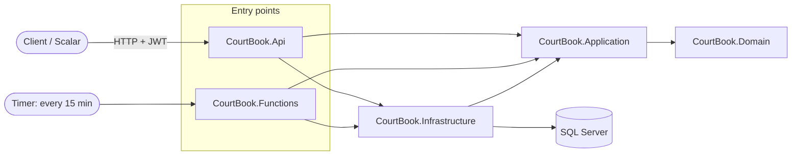

# CourtBook


A REST API for booking sports courts (padel, tennis, 5x5 football, basketball), built with **ASP.NET Core on .NET 10** following **Clean Architecture** and **Domain-Driven Design** principles.

Players browse sports centers, check real-time court availability and book slots. Managers configure centers, courts and opening hours. A serverless background job closes finished bookings automatically.

## Features

- **Sports centers & courts**: create centers, add courts, set weekly opening hours, activate/deactivate courts
- **Availability**: free time slots per court and day, in 30-minute steps
- **Bookings** with business rules:
  - 60 or 90 minute slots, only within opening hours, only on active courts
  - no overlapping bookings on the same court
  - at most 3 active bookings per player
  - peak/off-peak pricing (configurable)
  - late cancellations (< 24h before start) are flagged
- **Authentication & authorization**: ASP.NET Core Identity, JWT bearer tokens, roles (`Player`, `Manager`, `Admin`)
- **Concurrency-safe booking**: simultaneous requests for the same slot cannot create double bookings
- **Background job**: Azure Function (timer trigger) marks finished bookings as `Completed`
- **Health checks**: liveness and readiness (database) endpoints
- **Consistent errors**: RFC 7807 Problem Details for every failure

## Tech stack

| Area | Technology |
|---|---|
| Runtime | .NET 10, C# |
| Web API | ASP.NET Core, OpenAPI, Scalar |
| Data | Entity Framework Core, SQL Server |
| Security | ASP.NET Core Identity, JWT |
| Background jobs | Azure Functions (isolated worker, timer trigger) |
| Testing | xUnit, SQLite in-memory, Testcontainers, WebApplicationFactory |
| DevOps | Docker, Docker Compose, GitHub Actions |

## Architecture



Dependencies point **inwards**. The Domain has no dependencies at all.

| Project | Responsibility |
|---|---|
| **Domain** | Entities (`SportsCenter`, `Court`, `Booking`), value objects (`Money`, `DailyOpeningHours`), business invariants |
| **Application** | Use cases (services), DTOs, booking rules, pricing, interfaces (`IAppDbContext`, `ICurrentUser`) |
| **Infrastructure** | EF Core, migrations, Identity, JWT generation, health checks |
| **Api** | Controllers, authentication setup, global exception handling |
| **Functions** | Serverless background jobs reusing the Application layer |

## Design decisions

- **Rich domain model**: entities protect their own state (private setters, guard clauses, aggregate root `SportsCenter` owns its `Court`s). Invalid states cannot be created.
- **Value objects as records**: `Money` and `DailyOpeningHours` are immutable and validated on creation.
- **Strategy pattern for booking rules**: each rule implements `IBookingRule`. New rules are added without changing the booking service (Open/Closed principle).
- **Optimistic concurrency**: a `BookingVersion` concurrency token on `Court` makes simultaneous bookings for the same court conflict at the database level. The loser receives `409 Conflict`. Proven by an integration test with 10 parallel requests against real SQL Server.
- **Testable time**: all time-dependent code uses `TimeProvider`, so tests control "now".
- **Secure by default**: a fallback authorization policy requires authentication everywhere; public endpoints opt out explicitly.
- **No secrets in source control**: User Secrets locally, environment variables in Docker.

## Getting started

### Run everything with Docker (recommended)

Requirements: [Docker Desktop](https://www.docker.com/products/docker-desktop/)

```bash
git clone https://github.com/georgexar/CourtBook.git
cd CourtBook
cp .env.example .env        # PowerShell: Copy-Item .env.example .env
docker compose up -d --build
```

When both containers are `healthy` (`docker compose ps`), open:

- API documentation: http://localhost:8080/scalar
- Health: http://localhost:8080/health/ready

Log in with the admin credentials from `.env` via `POST /api/auth/login`, then send the token as `Authorization: Bearer <token>`.

### Run from Visual Studio

1. Start only the database: `docker compose up -d sqlserver`
2. Set User Secrets for `CourtBook.Api`: `ConnectionStrings:CourtBookDb`, `Jwt:SigningKey`, `SeedAdmin:Email`, `SeedAdmin:Password`
3. Apply migrations: `dotnet ef database update --project src/CourtBook.Infrastructure --startup-project src/CourtBook.Api`
4. Run `CourtBook.Api`

## Testing

```bash
dotnet test
```

| Suite | What it covers | Needs Docker |
|---|---|---|
| **UnitTests** | Domain, booking rules, pricing, availability, services (SQLite in-memory) | No |
| **IntegrationTests** | Full HTTP pipeline with real SQL Server (Testcontainers): auth, roles, bookings, health checks, concurrency | Yes |

All tests run on every push via GitHub Actions, followed by a Docker smoke test.

## API overview

| Method | Endpoint | Access |
|---|---|---|
| POST | `/api/auth/register`, `/api/auth/login` | Anonymous |
| GET | `/api/centers`, `/api/centers/{id}` | Anonymous |
| POST | `/api/centers` | Manager, Admin |
| PUT | `/api/centers/{id}/opening-hours` | Manager, Admin |
| POST | `/api/centers/{centerId}/courts` | Manager, Admin |
| POST | `/api/centers/{centerId}/courts/{courtId}/activate` · `/deactivate` | Manager, Admin |
| GET | `/api/courts/{courtId}/availability?date=&duration=` | Anonymous |
| POST | `/api/bookings` | Authenticated |
| GET | `/api/bookings/me`, `/api/bookings/{id}` | Authenticated (own bookings) |
| POST | `/api/bookings/{id}/cancel` | Authenticated (own bookings) |
| GET / POST / DELETE | `/api/admin/users...` | Admin |
| GET | `/health/live`, `/health/ready` | Anonymous |

## Possible improvements

- Opening hours past midnight
- Managers restricted to their own sports centers
- Refresh tokens
- Member discounts